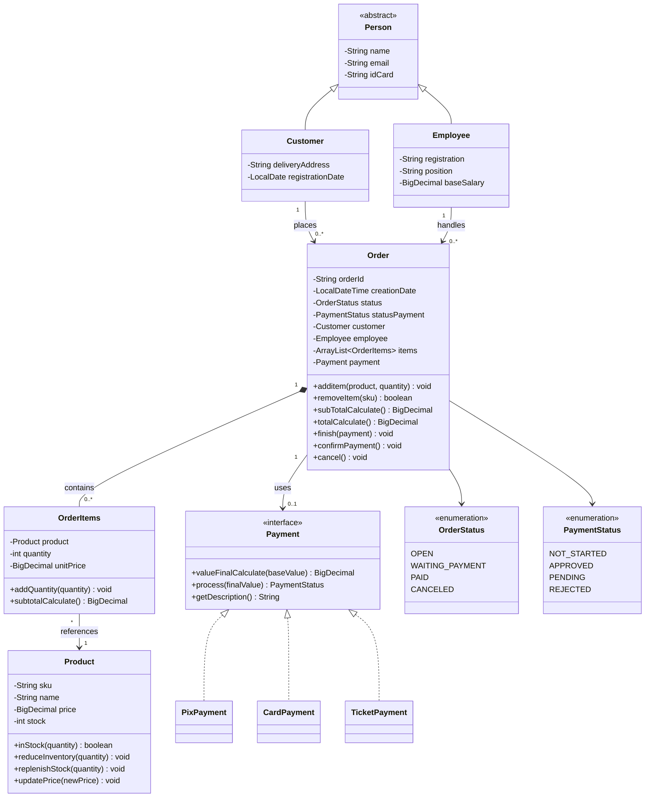

# Sistema de Vendas em Java

Projeto pessoal de estudos desenvolvido para praticar os fundamentos de Java e Programação Orientada a Objetos (POO) por meio da modelagem de um sistema de vendas executado pelo console.

> **Status:** em desenvolvimento. Este é um projeto de aprendizado: os pagamentos são simulados e não existe conexão com bancos, adquirentes ou serviços financeiros reais.

## Sobre o projeto

Comecei recentemente a estudar Java e criei este projeto para transformar os conceitos que venho aprendendo em código. A proposta é modelar as principais partes de uma venda — clientes, funcionários, produtos, itens e pedidos — e praticar como as classes colaboram para aplicar regras de negócio.

## Funcionalidades

- Modelagem de pessoas usando a classe abstrata `Person`, especializada em `Customer` e `Employee`.
- Cadastro de produtos com SKU, preço e estoque mantidos em memória.
- Criação de pedidos com identificador único, data de criação, cliente, funcionário, itens e estados.
- Adição e remoção de itens e cálculo de subtotal e total do pedido.
- Armazenamento do preço unitário no momento em que um item é criado, preservando o preço histórico daquela linha do pedido.
- Interface `Payment` para tratar diferentes formas de pagamento de modo polimórfico.
- Simulação de pagamentos por Pix, cartão de crédito e boleto.
- Controle dos estados do pedido (`OrderStatus`) e do pagamento (`PaymentStatus`) por meio de `enum`.
- Validações de entrada e tratamento de exceções, incluindo `IllegalArgumentException` e `IllegalStateException`.

## Regras de pagamento simuladas

| Forma de pagamento | Regra de cálculo | Resultado simulado |
|---|---|---|
| Pix | Desconto de 5% | Aprovação simulada quando a chave passa pela validação básica |
| Cartão de crédito | Sem acréscimo em 1 parcela; acréscimo único de 2% de 2 a 6 parcelas | Aprovação simulada quando os dados básicos passam pelas validações |
| Boleto | Desconto de 3% | Fica pendente até a confirmação manual |

Essas regras têm finalidade exclusivamente educacional. A validação de um formato não confirma que uma chave Pix, um cartão ou um boleto seja real ou válido em uma instituição financeira.

## Conceitos praticados

- **Abstração:** classe abstrata `Person`.
- **Herança:** `Customer` e `Employee` estendem `Person`.
- **Encapsulamento:** atributos privados e acesso controlado aos dados por meio dos métodos das classes.
- **Polimorfismo:** o pedido interage com o contrato `Payment`, sem depender diretamente de uma forma de pagamento específica.
- **Interfaces:** contrato comum para calcular, processar e descrever pagamentos.
- **Composição e associação:** um `Order` contém itens; cada `OrderItems` referencia um `Product`; os pedidos se relacionam com clientes, funcionários e pagamentos.
- **Enums:** representação dos estados de pedidos e pagamentos.
- **Collections:** lista de itens do pedido com `ArrayList`.
- **Datas:** `LocalDate` e `LocalDateTime`.
- **Valores monetários:** `BigDecimal` para cálculos de valores.
- **Identificadores:** `UUID` para gerar identificadores de pedido.
- **Exceções:** tratamento de argumentos inválidos e operações incompatíveis com o estado do objeto.

## Tecnologias

- Java (desenvolvido com JDK 26).
- IntelliJ IDEA.
- APIs padrão do Java, sem dependências externas necessárias para o modelo atual.

## Estrutura do projeto

```text
SistemaVendas/
├── src/
│   ├── Main.java
│   └── entities/
│       ├── Person.java
│       ├── Customer.java
│       ├── Employee.java
│       ├── Product.java
│       ├── Order.java
│       ├── OrderItems.java
│       ├── enums/
│       │   ├── OrderStatus.java
│       │   └── PaymentStatus.java
│       └── payments/
│           ├── Payment.java
│           ├── PixPayment.java
│           ├── CardPayment.java
│           └── TicketPayment.java
├── .gitignore
└── README.md
```

## Diagrama de classes



## Como executar

1. Instale um JDK compatível com o projeto e abra a pasta no IntelliJ IDEA.
2. Em **File → Project Structure**, confira se o SDK do projeto aponta para o JDK instalado.
3. Confirme que a pasta `src` está marcada como **Sources Root** e que os arquivos estão nos diretórios correspondentes às declarações `package`.
4. Abra `Main.java` e execute o método `main()` pelo IntelliJ.
5. Confira o console para acompanhar os resultados dos cálculos, os estados do pedido e as exceções dos cenários executados.

## Cenários para testar

- Criar produtos com dados válidos e tentar informar preço ou estoque inválidos.
- Criar um pedido e conferir o subtotal de vários itens.
- Tentar adicionar produto nulo, quantidade zero ou quantidade negativa.
- Simular Pix aprovado, cartão recusado por dados inválidos e boleto pendente.
- Confirmar manualmente um pagamento pendente e conferir os estados do pedido e do pagamento.
- Tentar comprar mais unidades do que existem em estoque.
- Tentar adicionar itens ou finalizar pedidos pagos, cancelados ou aguardando pagamento.
- Verificar se as exceções são lançadas e tratadas sem deixar o pedido ou o estoque em estado inconsistente.

Os cenários são executados manualmente pelo `Main`. Testes automatizados com JUnit ainda podem ser adicionados como evolução do projeto.

## Próximas melhorias

- Consolidar em uma única linha os itens com o mesmo SKU e validar a quantidade total solicitada.
- Verificar a disponibilidade de todos os produtos antes de baixar qualquer estoque, tanto na aprovação imediata quanto na confirmação de boleto.
- Restringir a remoção de itens aos pedidos em estado permitido.
- Reforçar as validações dos métodos de reposição de estoque e atualização de preço.
- Criar testes automatizados para cálculos, validações, estados e estoque.
- Avaliar futuramente persistência em banco de dados e uma interface além do console.

## Escopo e limitações

Este projeto tem finalidade de estudo e portfólio. Os dados ficam em memória e são perdidos ao encerrar o programa. Não há interface gráfica, autenticação, integração financeira ou persistência em banco de dados.

---

Projeto desenvolvido para praticar Java, aprender com erros, corrigir regras de negócio e evoluir gradualmente na programação orientada a objetos.
