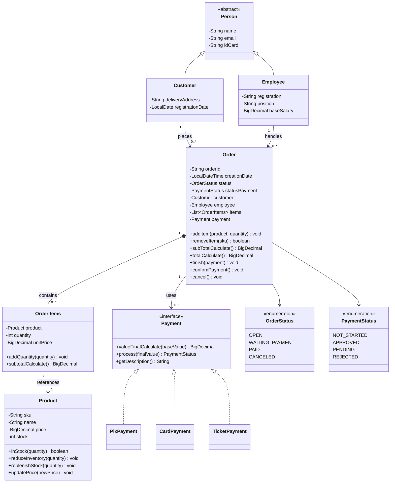

# Sistema de Vendas em Java

Projeto educacional de um sistema de vendas executado pelo console, desenvolvido para praticar Programação Orientada a Objetos (POO), validações e regras de negócio em Java.

> **Status:** em desenvolvimento. Os pagamentos são simulados: o sistema não se conecta a bancos, adquirentes ou serviços de pagamento reais.

## Objetivo

Modelar o fluxo básico de uma venda: representar clientes, funcionários e produtos; montar pedidos; calcular valores; simular diferentes formas de pagamento; e controlar os estados do pedido e do pagamento.

## Funcionalidades

- Modelagem de pessoas por meio da classe abstrata `Person`, especializada em `Customer` e `Employee`.
- Cadastro de produtos com SKU, preço e estoque em memória.
- Criação de pedidos com identificador único, data de criação, cliente, funcionário, itens e estados.
- Adição e remoção de itens e cálculo do subtotal do pedido.
- Registro do preço unitário do produto no momento em que o item é criado, preservando o valor histórico daquele item.
- Interface `Payment` para tratar as formas de pagamento de maneira polimórfica.
- Simulação de Pix e cartão de crédito na versão atual revisada; boleto faz parte do escopo, mas a classe precisa estar alinhada aos nomes atuais dos enums antes da publicação.
- Estados do pedido (`OrderStatus`) e do pagamento (`PaymentStatus`) representados por `enum`.
- Validações com exceções como `IllegalArgumentException` e `IllegalStateException`.

Os dados são mantidos em memória; não há banco de dados nem persistência entre execuções.

## Regras de pagamento simuladas

| Forma de pagamento | Regra do exercício | Resultado simulado |
|---|---|---|
| Pix | Desconto de 5% | Aprovado quando a chave passa pela validação básica |
| Cartão de crédito | Sem acréscimo em 1 parcela; acréscimo único de 2% em 2 a 6 parcelas | Aprovado quando os últimos quatro dígitos e a quantidade de parcelas passam pelas validações básicas |
| Boleto (escopo previsto) | Desconto de 3% | Deve ficar pendente até confirmação manual; confirme a versão atual da classe antes de publicar |

Essas regras são exclusivamente didáticas. Uma validação de formato não confirma que uma chave, cartão ou boleto seja real ou válido em um sistema financeiro.

## Conceitos de Java praticados

- **Abstração:** classe abstrata `Person`.
- **Herança:** `Customer` e `Employee` estendem `Person`.
- **Encapsulamento:** objetivo de manter os atributos `private` e controlar o acesso ao estado dos objetos por métodos de domínio; confirme que a versão enviada ao GitHub contém essa revisão.
- **Polimorfismo:** o pedido utiliza o contrato da interface `Payment`, sem precisar depender de uma implementação específica.
- **Interfaces:** contrato comum para calcular, processar e descrever pagamentos.
- **Composição e associação:** um `Order` contém itens; cada `OrderItems` referencia um `Product`; pedidos se relacionam com clientes, funcionários e pagamentos.
- **Enums:** controle dos estados de pedido e pagamento.
- **Collections:** lista de itens do pedido.
- **Datas:** `LocalDate` e `LocalDateTime`.
- **Valores monetários:** `BigDecimal` para operações financeiras.
- **Exceções:** rejeição de argumentos inválidos e operações incompatíveis com o estado do pedido.

## Tecnologias

- Java — desenvolvido com JDK 26.
- IntelliJ IDEA.
- APIs padrão do Java; o modelo atual não exige bibliotecas externas.

## Estrutura de pacotes

A organização esperada do código é semelhante à seguinte. Ajuste os nomes da árvore para refletir os arquivos efetivamente presentes no repositório antes de publicar.

```text
SistemaVendas/
├── src/
│   ├── Main.java
│   └── entities/
│       ├── Person.java
│       ├── Customer.java
│       ├── Employee.java
│       ├── Product.java
│       ├── Order.java
│       ├── OrderItems.java
│       ├── enums/
│       │   ├── OrderStatus.java
│       │   └── PaymentStatus.java
│       └── payments/
│           ├── Payment.java
│           ├── PixPayment.java
│           ├── CardPayment.java
│           └── TicketPayment.java
├── .gitignore
└── README.md
```

## Diagrama de classes



## Como executar

1. Instale um JDK e abra o projeto no IntelliJ IDEA.
2. Confira em **File → Project Structure** se o SDK do projeto está apontando para o JDK instalado.
3. Confirme que `src` está marcada como **Sources Root** e que os arquivos estão nos diretórios correspondentes aos seus `package`.
4. Abra `Main.java` e execute o método `main()` pelo IntelliJ.
5. Confira as mensagens no console para verificar cálculos, mudanças de estado e exceções.

## Cenários de teste recomendados

- Criar produtos válidos e tentar criar produtos com preço zero/negativo ou estoque negativo.
- Criar um pedido e conferir o subtotal de vários itens.
- Rejeitar produto nulo e quantidade zero ou negativa.
- Testar Pix aprovado, cartão recusado por dados inválidos e boleto pendente.
- Confirmar um pagamento pendente e conferir os estados do pedido e do pagamento.
- Tentar comprar mais unidades do que existem no estoque.
- Tentar adicionar itens ou finalizar pedidos pagos, cancelados ou aguardando pagamento.
- Conferir se operações inválidas geram exceções apropriadas sem deixar o pedido ou o estoque em estado inconsistente.

Os cenários são atualmente voltados a testes manuais pelo `Main`. Testes automatizados com JUnit podem ser adicionados futuramente.

## Pontos para revisar antes da primeira versão pública

- Confirmar que todos os atributos da versão a publicar estão declarados como `private` e que a lista interna de itens não pode ser modificada diretamente a partir de `getItems()`.
- Garantir que a adição repetida do mesmo SKU atualize a linha existente e que a soma das quantidades não ultrapasse o estoque.
- Verificar a disponibilidade de todos os produtos antes de baixar qualquer estoque, tanto no pagamento imediato quanto na confirmação de boleto.
- Validar as entradas de `replenishStock()` e `updatePrice()` para evitar estoque ou preço inválidos.
- Garantir que `removeItem()` só possa alterar pedidos em estado permitido.
- Confirmar que o arquivo de boleto foi renomeado para `TicketPayment.java` e utiliza `PaymentStatus`, de forma consistente com as classes atuais.
- Adicionar testes automatizados para cálculos, validações, estados e estoque.

## Escopo e limitações

Este projeto tem finalidade de estudo e portfólio. Os pagamentos são simulações locais; não há integração financeira, autenticação, persistência em banco de dados ou interface gráfica. O fluxo de estoque e os testes devem continuar sendo revisados antes de considerar o sistema pronto para uso real.
